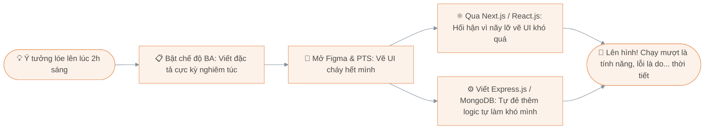

<div align="center">

  <!-- Banner đầu trang -->
  

</div>

### 👋 Chào đằng ấy đã đi lạc vào đây!

Người ta thường bảo trong một dự án: *Dev hay kêu ca Designer vẽ vời bay bổng, còn cả hai thì hay thở dài vì BA đổi yêu cầu liên tục.* 

Để giải quyết triệt để mâu thuẫn này và giữ gìn hòa bình thế giới, mình quyết định... **ôm luôn cả 3 việc**. Từ đó mỗi khi dự án có biến, mình chỉ cần đứng trước gương tự trách bản thân là xong, khỏi mất công cãi nhau với ai:

* 📋 **Khi nhập vai BA:** Viết tài liệu, vẽ luồng hệ thống rõ ràng rành mạch. Thỉnh thoảng sau 2 tuần mở ra đọc lại vẫn tự thắc mắc: *"Ủa ai viết cái yêu cầu gì mà khó chiều thế nhỉ?"* (À, chính mình).
* 🎨 **Khi bật Figma & Photoshop:** Lúc kéo thả trên **Figma** thì tâm hồn nghệ sĩ dạt dào, hiệu ứng bóng đổ lung linh... hoàn toàn quên mất lát nữa chính mình là đứa phải ngồi code đống giao diện đó. Còn **Photoshop** thì 50% dùng để chỉnh ảnh dự án, 50% dùng để chế meme đi comment dạo.
* 💻 **Khi ngồi vào bàn làm Dev:** Tự dựng giao diện bằng **React.js, Next.js**, kiêm luôn phần hậu cần phía sau với **Express.js** và **MongoDB**. Một quy trình khép kín hoàn hảo: *Tự tạo bug ở Database $\rightarrow$ Tự viết API đẩy lỗi đi $\rightarrow$ Tự ngồi khóc ở màn hình Frontend*.
* ⭐ **Sở thích phụ:** Đi dạo GitHub thả sao (star) cho mấy repo hay ho rồi để đó... năm sau mở ra xem.

```text
      )  (
     (   ) )
      ) ( (
    _______)_
 .-'---------|  
( C|/\/\/\/\/|
 '-./\/\/\/\/|
   '_________'
    '-------'
  Uống miếng cà phê lấy sức tự tranh luận với chính mình...
```

---

### 🎢 Quy trình một chiếc dự án ra đời tại đây

*(Sơ đồ này mô tả chân thực vòng lặp cảm xúc mỗi khi mình bắt đầu làm một cái gì đó mới)*



---

### 🧰 Bộ đồ nghề "Tự làm tự chịu" của mình

<div align="center">

| 💻 Đồ nghề gõ Code | 🎨 Đồ nghề vẽ vời | 📋 Đồ nghề nghĩ ngợi (BA) |
| :---: | :---: | :---: |
|  |  |  |
|  |  |  |
|  |  |  |
|  |  |  |

<br />

<!-- Hàng Icon trực quan -->


</div>

---

```text
   |\      _,,,---,,_
   /,`.-'`'    -.  ;-;;,_
  |,4-  ) )-,_. ,\ (  `'-'
 '---''(_/--'  `-'\_)      Làm xong hết rồi, đi ngủ thôi. Chúc bạn một ngày không có bug! 🌷
```

<div align="center">
  
</div>
